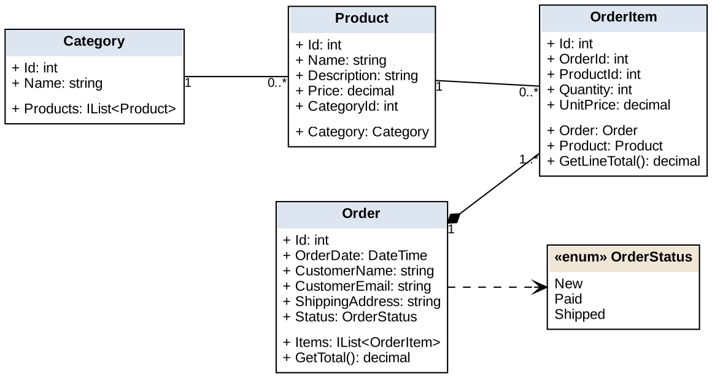

# E-poe modelleerimine

Georg Volov, KTA-25

## Sisend

Soovime luua e-poe oma toodete müügiks. E-pood koosneb toodete kategooriatest (üks tase), toodetest ja tellimustest. Toodete kategooriate jaoks on piisav kui on kategooria nimetus. Toote kohta soovime hoida nimetust, kirjeldust, toote fotot ja hinda. Tellimus koosneb alati toodetest. Tellimusega koos salvestame ka toodete hetkehinnad, sest hinnad võivad muutuda (sooduskampaaniad jne).

Lihtsuse huvides algul arveid ja makseid süsteemis eraldi ei hoia, sest tellimuse eest peab klient maksma koheselt. Tellimuse viime makstud staatusesse kui klient on makse teinud ja seejärel võib ladu talle kauba välja saata ning määrata tellimuse tarnitud staatusesse.

## Klassid

diagrams.net fail: [klassiskeem.drawio](klassiskeem.drawio)

## Omadused

| Omadus | Tüüp | Pikkus | Kohustuslik | Unikaalne |
|---|---|---|---|---|
| **Category** | | | | |
| Id | int | | + | + |
| Name | string | 100 | + | + |
| **Product** | | | | |
| Id | int | | + | + |
| Name | string | 200 | + | |
| Description | string | 2000 | | |
| Price | decimal | | + | |
| CategoryId | int | | + | |
| **Order** | | | | |
| Id | int | | + | + |
| OrderDate | DateTime | | + | |
| CustomerName | string | 100 | + | |
| CustomerEmail | string | 100 | + | |
| ShippingAddress | string | 300 | + | |
| Status | OrderStatus | | + | |
| **OrderItem** | | | | |
| Id | int | | + | + |
| OrderId | int | | + | |
| ProductId | int | | + | |
| Quantity | int | | + | |
| UnitPrice | decimal | | + | |

OrderStatus väärtused: New (uus), Paid (makstud), Shipped (tarnitud).

Arvutatavad väärtused (andmebaasis ei hoita):

- OrderItem.GetLineTotal() = Quantity × UnitPrice
- Order.GetTotal() = kõigi ridade GetLineTotal() summa

## Reeglid

- Kategooria nimi peab olema unikaalne
- Kategooriat, millel on tooteid, ei saa kustutada
- Toote hind peab olema suurem kui 0, kuni 2 komakohta
- Toode peab kuuluma olemasolevasse kategooriasse
- Toodet, mis on mõnes tellimuses, ei saa kustutada
- Toote fotod hoitakse failidena kaustas photos/{toote id}; lubatud on .jpg, .jpeg, .png, .webp kuni 5 MB
- Tellimuse rea UnitPrice võetakse toote hetkehinnast rea lisamisel; hilisem toote hinna muutus ei muuda vanu tellimusi
- Kogus peab olema vahemikus 1–1000
- Sama toode on ühes tellimuses ainult ühel real
- Tellimus koosneb alati toodetest: viimast rida ei saa kustutada (kustuta siis kogu tellimus)
- Uus tellimus on alati staatuses New, tellimuse kuupäev pannakse loomisel automaatselt
- Staatus muutub ainult edasi ja ühe sammu kaupa: New → Paid → Shipped
- Tellimust ilma toodeteta ei saa märkida makstuks
- Tellimuse ridu saab muuta ja tellimust kustutada ainult staatuses New
- Kliendi e-post peab olema korrektne e-posti aadress
